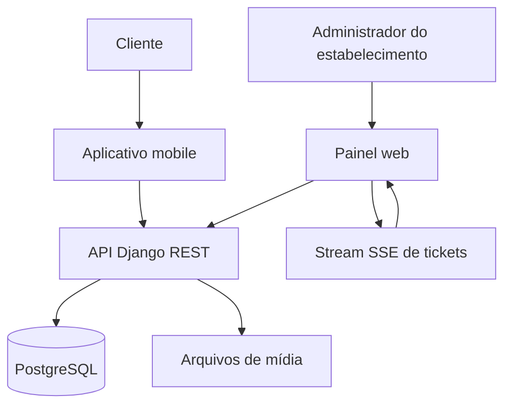

# JanuPoints
[Diagrama Entidade-Relacionamento](/docs/diagram_er.md) | [Diagrama de Classes](/docs/diagrama_classes.md) | [Requisitos Funcionais e Não Funcionais](/docs/requisitos.md) | [Fluxo de Requisições](/docs/fluxo_requisicao.md) | [Endpoints](/docs/endpoints.md) | [Execução](/app/execucao/exec.md)

---

## 1. Visão geral

JanuPoints é uma plataforma de fidelização baseada em pontos. O cliente consulta estabelecimentos parceiros, envia notas fiscais para acumular pontos e utiliza o saldo para resgatar recompensas.

A plataforma possui dois públicos principais:

- **Cliente:** utiliza o aplicativo mobile para consultar parceiros, acompanhar o saldo, enviar notas fiscais, resgatar recompensas e acompanhar suas operações.
- **Administrador do estabelecimento:** utiliza o painel web para analisar solicitações, administrar recompensas e atualizar os dados do estabelecimento.

O ciclo principal da aplicação é:

```text
Cliente consulta um estabelecimento
  -> envia uma nota fiscal
  -> administrador analisa a solicitação
  -> pontos são creditados
  -> cliente escolhe uma recompensa
  -> pontos são debitados
  -> administrador acompanha o resgate
```

### Objetivos

- Incentivar o consumo em estabelecimentos parceiros.
- Centralizar o controle de pontos e recompensas.
- Permitir análise de notas fiscais pelo estabelecimento.
- Oferecer acompanhamento dos pedidos de acúmulo e resgate.
- Manter o painel do estabelecimento atualizado por eventos SSE.

---

## 2. Arquitetura

O projeto é organizado em três aplicações:

```text
JanuPoints-TCC/
├── app/
│   ├── backend/          # API Django e banco PostgreSQL
│   ├── frontend-mobile/  # Aplicativo Expo/React Native
│   ├── frontend-web/     # Painel web Vite/Bootstrap
│   └── execucao/         # Instruções de execução
├── docs/                 # Documentação técnica
└── README.md
```

### Componentes



### Tecnologias

- **Backend:** Python, Django, Django REST Framework.
- **Autenticação:** JWT com refresh token e blacklist de tokens.
- **Banco de dados:** PostgreSQL.
- **Aplicativo mobile:** Expo, React Native, Expo Router e TypeScript.
- **Painel web:** Vite, JavaScript ES Modules, HTML, CSS e Bootstrap.
- **Atualização da fila:** Server-Sent Events (SSE).
- **Arquivos:** armazenamento local de mídia durante a execução atual.
- **Orquestração local:** Docker Compose.

---

## 3. Estrutura do backend

O backend está em `app/backend/app` e possui os seguintes módulos ativos:

```text
app/backend/app/
├── config/           # settings, URLs, ASGI e WSGI
├── core/             # permissões, logging e comandos administrativos
├── usuarios/         # usuário, cliente, administrador e autenticação
├── estabelecimentos/ # estabelecimentos parceiros
├── produtos/         # recompensas do catálogo
├── tickets/          # acúmulos, resgates e stream SSE
└── manage.py
```

### Responsabilidades dos apps

- `usuarios`: modelo de usuário customizado com login por email, perfis de cliente e administrador e alteração de senha.
- `estabelecimentos`: consulta e atualização dos dados dos estabelecimentos.
- `produtos`: criação, consulta, atualização e exclusão de recompensas.
- `tickets`: operações de crédito e débito, aprovações, recusas, cancelamentos e atualização da fila.
- `core`: permissões compartilhadas, filtro de contexto de logging e comando para recalcular pontos.

---

## 4. Funcionalidades

### Aplicativo mobile

- Cadastro e login de clientes.
- Saldo de pontos.
- Consulta e busca de estabelecimentos.
- Consulta de recompensas.
- Captura de imagem da nota fiscal.
- Envio e acompanhamento de acúmulos.
- Solicitação e acompanhamento de resgates.
- Histórico de tickets de crédito e débito.
- Atualização dos dados pessoais.
- Alteração de senha e saída da conta.

### Painel web

- Login de administradores de estabelecimentos.
- Dashboard com solicitações abertas.
- Aprovação e recusa de tickets de crédito e débito.
- Atualização automática da fila por SSE.
- Cadastro, edição e exclusão de recompensas.
- Atualização de nome, endereço, telefone, descrição e logotipo do estabelecimento.

### Perfis de acesso

- **Cliente:** consulta parceiros e recompensas, gerencia os próprios dados, acumula pontos, solicita resgates e acompanha seus tickets.
- **Administrador do estabelecimento:** acessa o estabelecimento associado, administra recompensas e analisa solicitações relacionadas à empresa.
- **Superusuário:** possui acesso administrativo ampliado aos estabelecimentos, produtos e tickets.

### Interface e comunicação

- O aplicativo mobile utiliza Expo Router e navegação por abas.
- O painel web utiliza Vite, JavaScript modular e Bootstrap.
- A API utiliza JSON nas operações comuns e `multipart/form-data` para imagens.
- O painel recebe alterações da fila por Server-Sent Events.

---

## 5. Regras principais

- O cliente acumula pontos após a aprovação de um ticket de crédito.
- O valor dos pontos de um acúmulo é calculado com base no valor da nota e em `PONTOS_POR_REAL_GASTO`.
- O cliente só pode enviar notas de valor positivo, com data válida e número não duplicado no estabelecimento.
- O resgate exige saldo suficiente e produto ativo em estabelecimento ativo.
- Os pontos do resgate são debitados no momento da criação do ticket.
- O cancelamento ou a recusa de um resgate devolve os pontos ao cliente.
- O administrador só acessa tickets e produtos do estabelecimento associado, salvo superusuários da plataforma.
- O cliente só consulta e altera os próprios dados e tickets.

---

## 6. Execução rápida

### Backend

A partir de `app/backend`, configure o arquivo `.env` e execute:

```bash
docker compose build
docker compose up -d
docker compose exec app python manage.py migrate
```

A API ficará disponível em `http://localhost:8000`.

### Painel web

A partir de `app/frontend-web`:

```bash
npm install
npm run dev
```

O painel utiliza a API configurada em `app/frontend-web/januprime/src/js/config/app.js`.

### Aplicativo mobile

A partir de `app/frontend-mobile`:

```bash
npm install
npm run start
```

Consulte [Execução](/app/execucao/exec.md) para os comandos completos.

---

## 7. Documentação técnica

- [Requisitos Funcionais e Não Funcionais](/docs/requisitos.md)
- [Endpoints da API](/docs/endpoints.md)
- [Fluxo de Requisições](/docs/fluxo_requisicao.md)
- [Diagrama Entidade-Relacionamento](/docs/diagram_er.md)
- [Diagrama de Classes](/docs/diagrama_classes.md)
- [Instruções de Execução](/app/execucao/exec.md)
