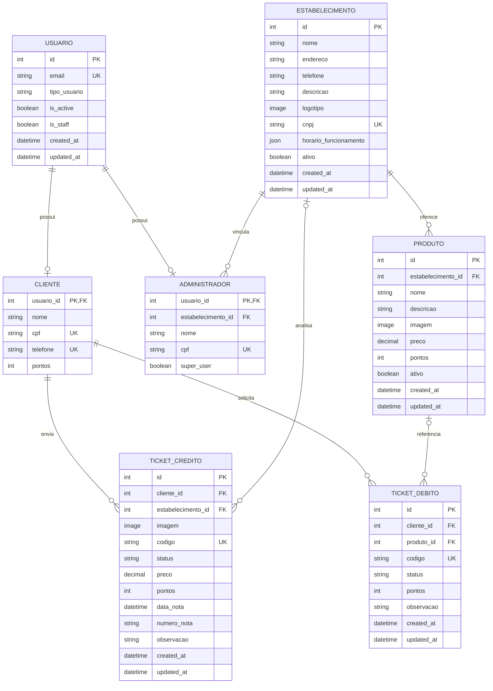

[Visão Geral](/README.md) | [Diagrama de Classes](/docs/diagrama_classes.md) | [Requisitos Funcionais e Não Funcionais](/docs/requisitos.md) | [Fluxo de Requisições](/docs/fluxo_requisicao.md) | [Endpoints](/docs/endpoints.md)

---

### Diagrama Entidade-Relacionamento

As entidades abaixo correspondem aos modelos ativos do backend.

### Regras de relacionamento

- `Usuario` é o modelo de autenticação e pode possuir um perfil `Cliente` ou `Administrador`.
- `Cliente` e `Administrador` usam `usuario_id` como chave primária e relação um-para-um.
- Um `Estabelecimento` possui administradores e recompensas.
- Um cliente pode enviar vários tickets de crédito e criar vários tickets de débito.
- Um ticket de crédito referencia diretamente o estabelecimento escolhido para a nota.
- Um ticket de débito referencia o produto resgatado; o estabelecimento é obtido por meio do produto.
- Tickets de crédito e débito mantêm o código, status, observação e datas de criação/atualização.
