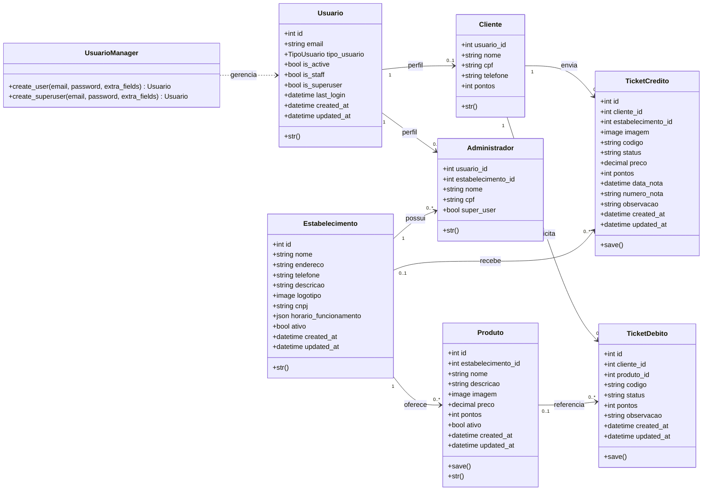

[Visão Geral](/README.md) | [Diagrama Entidade-Relacionamento](/docs/diagram_er.md) | [Requisitos Funcionais e Não Funcionais](/docs/requisitos.md) | [Fluxo de Requisições](/docs/fluxo_requisicao.md) | [Endpoints](/docs/endpoints.md)

---

### Diagrama de Classes

O diagrama representa as classes de domínio implementadas nos modelos Django. As ações HTTP, validações de entrada e permissões pertencem às camadas de views, serializers e permissions e não são métodos das entidades.

### Relações e responsabilidades

- `Usuario` é o modelo de autenticação e utiliza `email` como identificador.
- `Cliente` e `Administrador` são perfis vinculados a `Usuario` por relações um-para-um.
- `Administrador` pertence a um `Estabelecimento`.
- `Produto` pertence a um estabelecimento e calcula seu valor em pontos no método `save()`.
- `TicketCredito` referencia o cliente e o estabelecimento escolhido para a nota fiscal.
- `TicketDebito` referencia o cliente e o produto resgatado.
- Os métodos de aprovação, recusa, cancelamento e conclusão são ações HTTP implementadas nos viewsets de tickets, não métodos dos modelos.

### Classes auxiliares da aplicação

As classes abaixo participam da API, mas não fazem parte do diagrama de entidades:

- serializers: validam e transformam dados de entrada e saída;
- viewsets: expõem os endpoints REST;
- permissions: controlam o acesso por usuário e estabelecimento;
- `ticket_stream_view`: mantém a fila do painel atualizada por SSE.

Arquivos principais:

- `app/backend/app/usuarios/models/`
- `app/backend/app/estabelecimentos/models.py`
- `app/backend/app/produtos/models.py`
- `app/backend/app/tickets/models/`
- `app/backend/app/tickets/views/`
