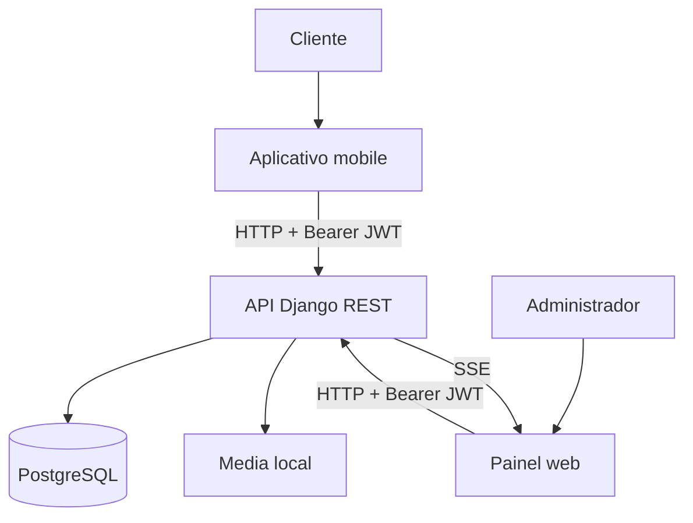
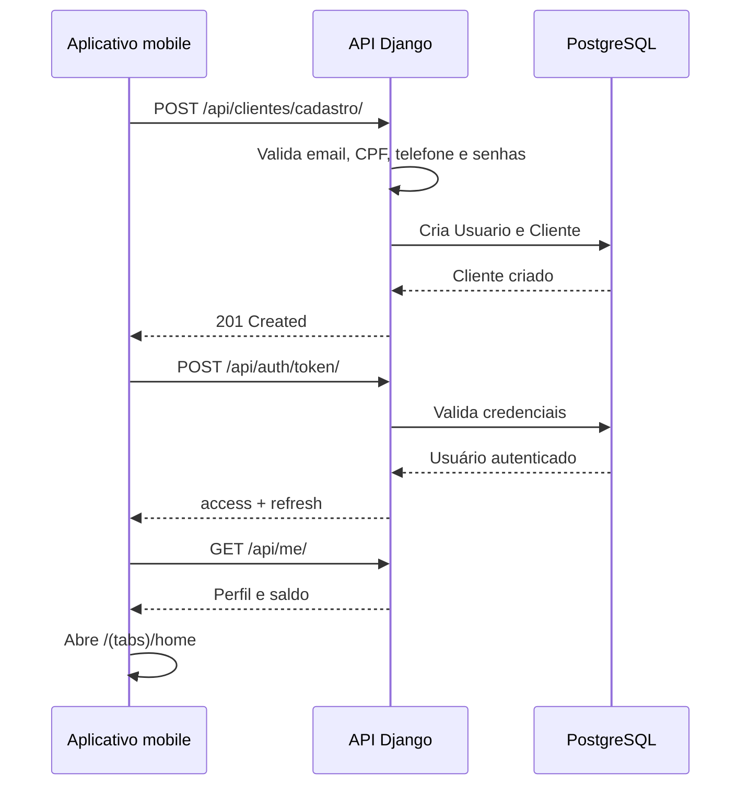
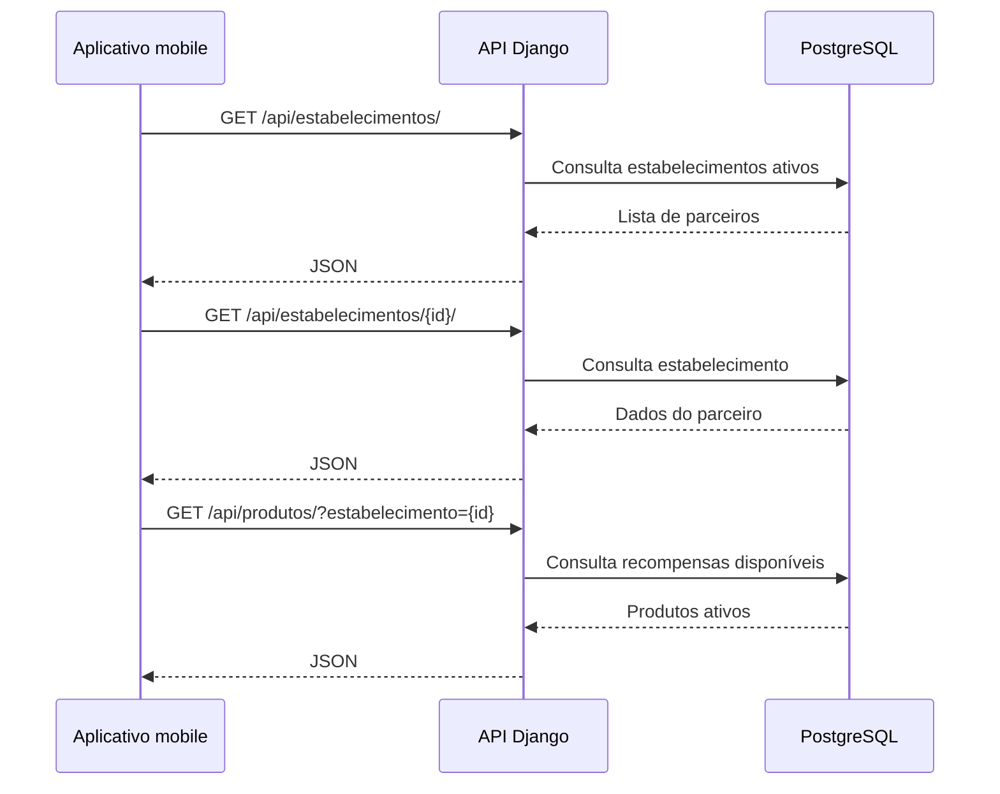
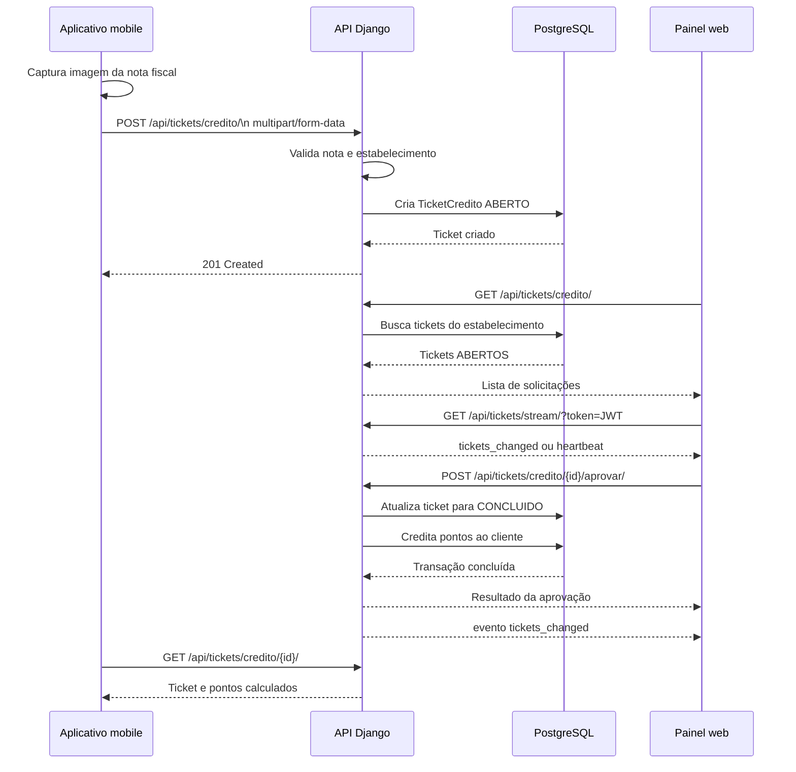
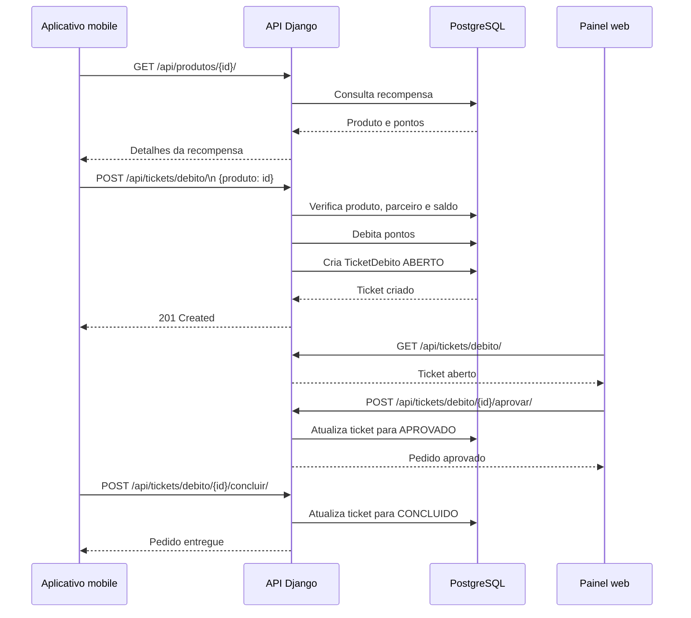
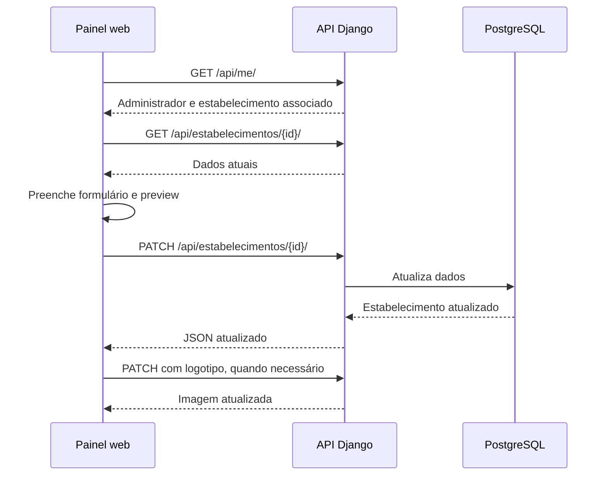
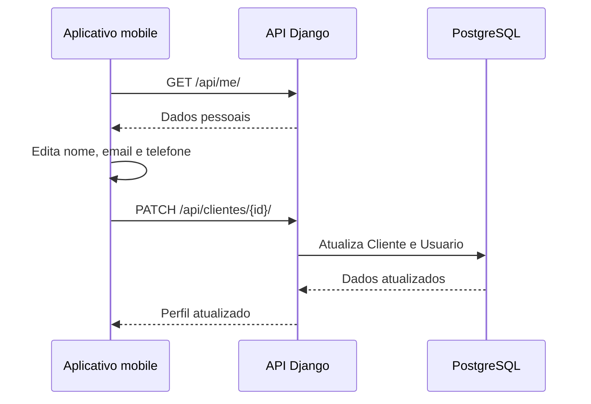

[Visão Geral](/README.md) | [Diagrama Entidade-Relacionamento](/docs/diagram_er.md) | [Diagrama de Classes](/docs/diagrama_classes.md) | [Requisitos Funcionais e Não Funcionais](/docs/requisitos.md) | [Endpoints](/docs/endpoints.md)

---

# Fluxo de Requisições

## 1. Comunicação entre as aplicações

O aplicativo mobile e o painel web consomem a API Django REST. Durante o desenvolvimento local, a comunicação utiliza HTTP. Em um ambiente publicado, o serviço deve ser colocado atrás de HTTPS.



### Autenticação comum

1. A aplicação envia email e senha para `/api/auth/token/`.
2. A API retorna `access` e `refresh`.
3. O cliente armazena os tokens.
4. As requisições protegidas enviam `Authorization: Bearer <access>`.
5. Ao receber `401`, o aplicativo mobile tenta renovar o access token com `/api/auth/token/refresh/`.
6. No logout, o refresh token é enviado para `/api/auth/logout/`.

---

## 2. Cadastro e primeiro acesso do cliente



### Validações

- email único;
- CPF válido e único;
- telefone válido e único;
- senha e confirmação iguais;
- senha submetida às validações do Django.

---

## 3. Consulta de estabelecimentos e recompensas



O painel web utiliza os mesmos recursos para consultar os dados do estabelecimento e carregar o catálogo.

---

## 4. Acúmulo de pontos

O acúmulo começa no aplicativo mobile e termina com a análise do estabelecimento.



### Dados enviados

```text
estabelecimento
imagem
preco
data_nota
numero_nota
```

### Decisão do estabelecimento

- **Aprovar:** o ticket passa para `CONCLUIDO` e os pontos são creditados.
- **Recusar:** o ticket passa para `RECUSADO` e recebe uma observação.
- **Cancelar pelo cliente:** permitido somente enquanto o ticket estiver `ABERTO`.

---

## 5. Resgate de uma recompensa



### Cancelamento e recusa

- O cliente pode cancelar um ticket `ABERTO`; os pontos são estornados.
- O administrador pode recusar um ticket `ABERTO`; os pontos são estornados.
- Um ticket só pode ser concluído quando estiver `APROVADO`.

---

## 6. Atualização da fila por SSE

O painel abre uma conexão com:

```text
GET /api/tickets/stream/?token=<access_token>
```

O backend:

1. valida o access token;
2. localiza o estabelecimento do administrador;
3. consulta os IDs dos tickets de crédito e débito com status `ABERTO`;
4. compara a lista atual com a lista anterior;
5. envia `tickets_changed` quando há alteração;
6. envia heartbeat quando não há alteração;
7. repete a verificação a cada dois segundos.

O painel recebe o evento e recarrega os dados do dashboard.

---

## 7. Atualização do perfil do estabelecimento



Campos editáveis apresentados no painel:

- nome;
- endereço;
- telefone;
- descrição;
- logotipo.

---

## 8. Atualização dos dados do cliente



O CPF é exibido como somente leitura.

---

## 9. Tratamento de erros

As aplicações apresentam estados de carregamento, erro e vazio. Os principais códigos HTTP utilizados são:

- `200 OK`: consulta ou atualização concluída.
- `201 Created`: recurso criado.
- `204 No Content`: recurso excluído.
- `400 Bad Request`: dados inválidos ou transição de status não permitida.
- `401 Unauthorized`: ausência ou invalidade do token.
- `403 Forbidden`: usuário sem permissão para o recurso.
- `404 Not Found`: recurso inexistente.

O aplicativo mobile interpreta mensagens `error`, `detail` e erros de validação retornados pelos serializers.
